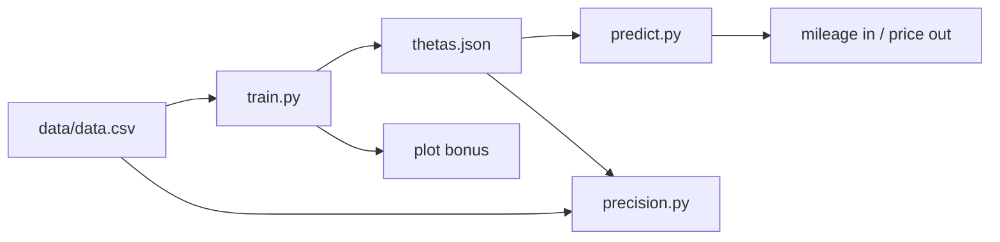

# ft_linear_regression — concepts, implementation, and defense docs

## What the subject actually requires

From [en.subject.pdf](c:\Users\hp\Desktop\ft_linear_regression\en.subject.pdf) (v4.1):

- **Goal:** predict car **price** from **mileage** with a **linear hypothesis** trained by **gradient descent**.
- **Two programs:**
  1. **Predict:** prompt for mileage, print estimated price using `estimatePrice(mileage) = θ0 + θ1 * mileage`. Before any training, `θ0 = θ1 = 0`.
  2. **Train:** read the dataset, run the **specified** updates, **save** `θ0` and `θ1` for the predict program.
- **Specified update (batch GD, simultaneous):**
  - `tmpθ0 = α * (1/m) * Σ (estimatePrice(mileage[i]) − price[i])`
  - `tmpθ1 = α * (1/m) * Σ (estimatePrice(mileage[i]) − price[i]) * mileage[i]`
  - then assign both at once (`θ0 ← tmpθ0` style: actually you **subtract** these from current θ — see concept section; the PDF writes the *gradient term*, not the full assignment).
- **Language:** any; you chose **Python**.
- **Libraries:** allowed unless they **fit the line for you** (e.g. `numpy.polyfit`, sklearn `LinearRegression` = cheating).
- **Visualization:** strongly recommended for debugging.
- **Bonuses (only if mandatory is perfect):** scatter of data, overlay of the regression line, a **precision** program.
- **Peer checks:** no cheating libs, **specified hypothesis**, **specified training function**.
- **AI chapter:** you must be able to **explain and defend** every decision; be **transparent** about AI use.

Dataset already in repo: [data/data.csv](c:\Users\hp\Desktop\ft_linear_regression\data\data.csv) — columns `km,price`, 24 rows. Mileage is large (~2e4–2.4e5); price is ~3.6k–8.3k. That scale mismatch is the main numerical trap.

The PDF does **not** list required README sections. README will still cover what evaluators need to **run** the project (usage, deps, dataset, no forbidden fitters). Deep theory and “oral exam” answers live in **[LEARNING.md](LEARNING.md)** (the file you re-read before push/defense).

---

## Phase 0 — How we will work (after you approve this plan)

This phase is **not coding yet**. Order:

1. You read this plan and say you understand it (or ask questions).
2. Then I act as assistant: we go **concept by concept**, each written into `LEARNING.md` in your own understanding (I explain, you challenge, we refine).
3. Only then we implement, with **every function** explained in `LEARNING.md` (what it does, why, how it maps to the PDF formulas).
4. Last: `README.md` for running the project + a short **AI-use** note (subject’s good-practice rule).

I will **not** dump a finished solution for you to paste. You must be able to derive the updates on a whiteboard.

---

## Phase 1 — Concepts you must own (defense-level)

These go into `LEARNING.md` with math, intuition, and “if the evaluator asks…” answers.

### 1. What “machine learning” means here

- Mitchell’s definition from the PDF: task **T**, experience **E**, performance **P**.
- Map this project: **T** = predict price from km; **E** = `data.csv`; **P** = how close predictions are (MSE / R², later).
- **Supervised learning** vs unsupervised; **regression** vs classification.
- **Model** vs **algorithm** vs **hypothesis**.

### 2. The hypothesis (mandatory formula)

- `hθ(x) = θ0 + θ1 x` with `x = mileage`, output = price.
- **θ0** = intercept (predicted price at 0 km — not realistic, but mathematically the bias).
- **θ1** = slope (expected **negative**: more km → cheaper).
- Why a **line** is enough for this dataset (roughly linear cloud) and what would break that assumption.

### 3. Cost function (PDF does not write it — evaluators still expect it)

- Residual: `hθ(x(i)) − y(i)`.
- Mean squared error: `J(θ0, θ1) = (1/(2m)) Σ (hθ(x(i)) − y(i))²` (the `1/2` is conventional so the derivative is clean).
- `m` = number of examples (here 24). That is the “I let you guess what m is” in the PDF.
- Why we minimize **average squared error**, not just “looks good on a plot”.

### 4. Gradient descent (the training function)

- Idea: walk downhill on `J`.
- Partial derivatives: `∂J/∂θ0` and `∂J/∂θ1` recover **exactly** the sums in the subject (up to the learning rate `α`).
- **Update:** `θj := θj − (that tmp term)`. The PDF shows the **gradient piece** (`learningRate * (1/m) * Σ …`); if you **assign** θ to that piece instead of subtracting, the model is wrong. You must be able to say this out loud.
- **Simultaneous update:** compute both tmps from the **same** current θ, then apply both. Updating θ0 then using the new θ0 for θ1 is a different (wrong for this subject) algorithm.
- **Batch** GD: one pass uses **all** `m` examples (what the formula is). Contrast with SGD / mini-batch (knowledge only, not required to code).
- **Learning rate α:** too big → diverge (cost explodes, NaN); too small → painfully slow. How you choose it (try values, watch cost).
- **Epoch / iteration:** one full update of θ using all data. Stopping: fixed N iterations, or cost change below epsilon.

### 5. Feature scaling (not in the PDF, often required to make GD work)

- Raw `km` ~ 10^5, residuals ~ 10^3–10^4 → `Σ error * mileage` is huge → you need a tiny α or it **diverges**.
- **Min-max** or **standardization** (`(x − mean) / std`) on mileage (and optionally price) **only during training**.
- **Critical:** predict program uses the PDF hypothesis on **raw mileage**. So either:
  - train on scaled x, then **convert** scaled θ back to raw θ before saving, **or**
  - save scaling parameters and apply them in predict (worse: predict formula no longer matches the subject’s `θ0 + θ1 * mileage` unless you fold scaling into θ).
- Preferred for 42: **normalize for GD, denormalize θ, save raw θ0/θ1**. Predict stays a one-liner as in the PDF.

### 6. Persistence and the two-program contract

- Train writes `theta0, theta1` to a file (e.g. `thetas.json` or `thetas.csv`).
- Predict reads that file; **if missing**, θ = 0 → estimated price **0**.
- Never hardcode trained θ in predict source.

### 7. Numerical / data hygiene

- CSV parsing, header row, empty file, non-numeric, `m = 0`.
- Mileage input: negative, non-number, empty.
- Overflow / NaN detection during training.

### 8. Bonuses — visualization and precision

- **Scatter:** km vs price (see the cloud and outliers).
- **Line:** plot `θ0 + θ1 x` over the same range as the data.
- **Precision:** at least one metric you can **define and justify**:
  - **MSE / RMSE** (same family as `J`)
  - **MAE** (easier to interpret in euros)
  - **R²** (fraction of variance explained; 1 = perfect, 0 = “as good as predicting the mean”)
- Do **not** compute precision with a library that also **fits** the model.

### 9. What is forbidden vs allowed (oral)

- **Forbidden:** `numpy.polyfit`, `scipy.stats.linregress` as the trainer, sklearn regressors, Excel trendline as the source of θ.
- **Allowed:** `csv` / pandas **only to load**, `matplotlib` to plot, numpy for arrays **if GD is still your loops/formulas**.
- You will implement the sums yourself so you can recode them from memory.

### 10. Evaluator-style questions to pre-write in LEARNING.md

Examples (full answers later in the file): What is m? Why simultaneous update? What happens if α is too large? Why is θ1 negative? What if we predict before training? Did you normalize, and how do saved θ still match the PDF formula? Difference between cost J and “precision”? Why not sklearn? How did you use AI?

---

## Phase 2 — Tools and project layout

**Runtime**

- Python 3.10+
- `matplotlib` (plots / bonus)
- Standard library `csv`, `json`, `argparse` or simple `input()`
- Optional: `venv` + `requirements.txt` with **only** matplotlib (and nothing that fits)

**Not used as solvers:** sklearn, polyfit, closed-form `θ = (XᵀX)⁻¹Xᵀy` as the *training program* (know it exists; subject wants GD).

**Proposed files** (names can stay simple for 42):

- `train.py` — load CSV, GD, save thetas, optional cost log
- `predict.py` — load thetas, prompt mileage, print price
- `precision.py` — load data + thetas, print MSE/MAE/R²
- `plot.py` or flags in train — scatter + line (bonus)
- `thetas.json` — generated, gitignored or documented as output
- `data/data.csv` — given dataset
- `requirements.txt`
- `README.md` — run instructions
- `LEARNING.md` — full theory + code walkthrough + defense Q&A + AI transparency

---

## Phase 3 — Implementation steps (after concepts)

Do these in order; each step is explained in `LEARNING.md` as you write it.

1. **Repo hygiene:** venv, `requirements.txt`, `.gitignore` (`__pycache__`, venv, maybe `thetas.json`).
2. **Load data:** parse `km` and `price` into two lists; define `m`; reject bad rows with a clear error.
3. **Predict skeleton:** loop `input` mileage → `θ0 + θ1 * x`; missing file → zeros; validate input.
4. **Train loop (raw, may diverge):** implement the PDF sums, **subtract** from θ, simultaneous tmp, print cost every N steps. Observe divergence — this is the teaching moment for scaling.
5. **Add feature scaling + denormalize θ** so saved θ work with raw km in predict.
6. **Tune α and iterations** until cost decreases and the line matches the scatter (visual debug).
7. **Save/load thetas** as the only coupling between programs.
8. **Bonus plot:** scatter + line on one figure.
9. **Bonus precision:** MSE, MAE, R² on the training set (honest: no train/test split required by subject; mention that limitation in LEARNING.md).
10. **Edge cases:** empty CSV, missing thetas, garbage mileage, huge mileage.
11. **README.md:** how to install, `python train.py`, `python predict.py`, `python precision.py`, plot, dataset path, library policy.
12. **LEARNING.md pass:** every function, every formula, expected θ sign, how to re-run, AI usage, likely oral questions.

**Acceptance checks (mandatory “perfect” before bonus credit):**

- Untrained predict → 0 (or 0 given θ=0).
- After train, predict is a decreasing function of km and plausible vs the CSV cloud.
- Training uses the **specified** sums and simultaneous update.
- No fitter library.
- Thetas persist across processes.

---

## Phase 4 — Documentation split

| File | Audience | Contents |
|------|----------|----------|
| [README.md](README.md) | Evaluator running the repo | Project name, what it does in one paragraph, Python version, `pip install -r requirements.txt`, commands for train / predict / plot / precision, dataset location, reminder that GD is implemented by hand |
| [LEARNING.md](LEARNING.md) | You, the night before defense | Mitchell + T/E/P, hypothesis, J, derivation of the PDF formulas, simultaneous update, α, scaling and denormalization algebra, `m`, data description, file-by-file / function-by-function explanation, bonus metrics definitions, forbidden libs, failure modes, oral Q&A, honest AI-use section |

`LEARNING.md` must be dense enough that **re-reading it once** reconstructs the whole project in your head. It is **not** a substitute for understanding: we fill it as we learn, not as a copy of a blog post.

---

## What we will not do

- Implement neural nets, multivariate regression, or sklearn pipelines.
- Use closed-form / polyfit as the official trainer.
- Put secret “correct θ” in the README instead of teaching GD.
